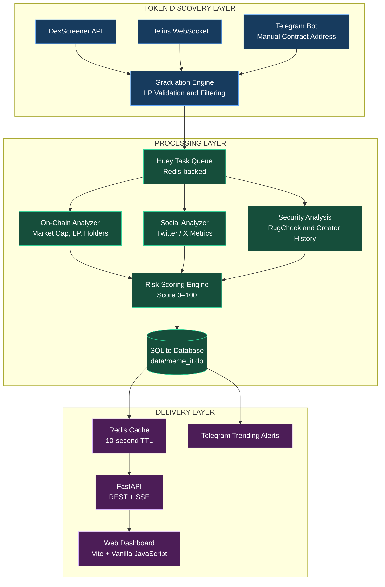
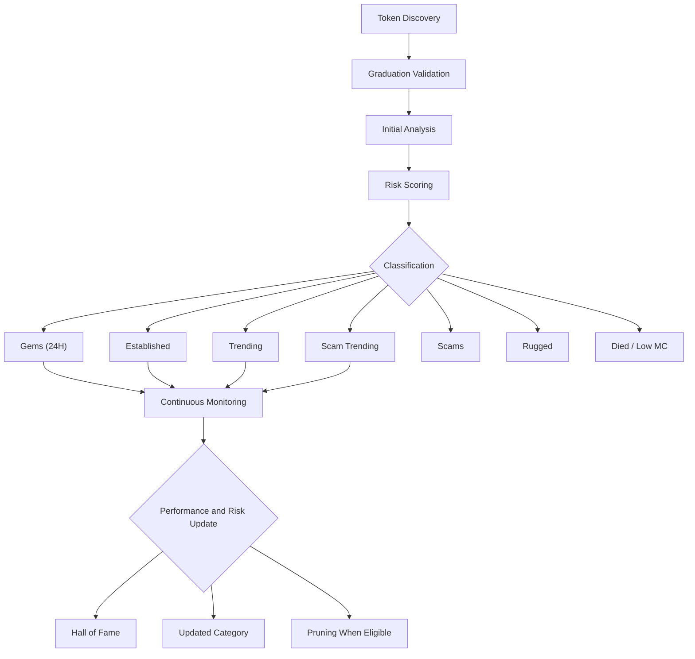
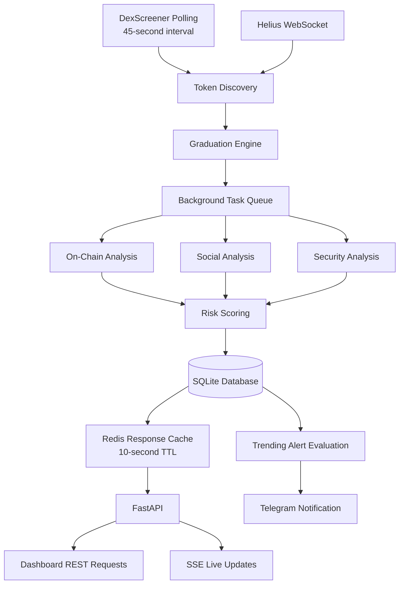
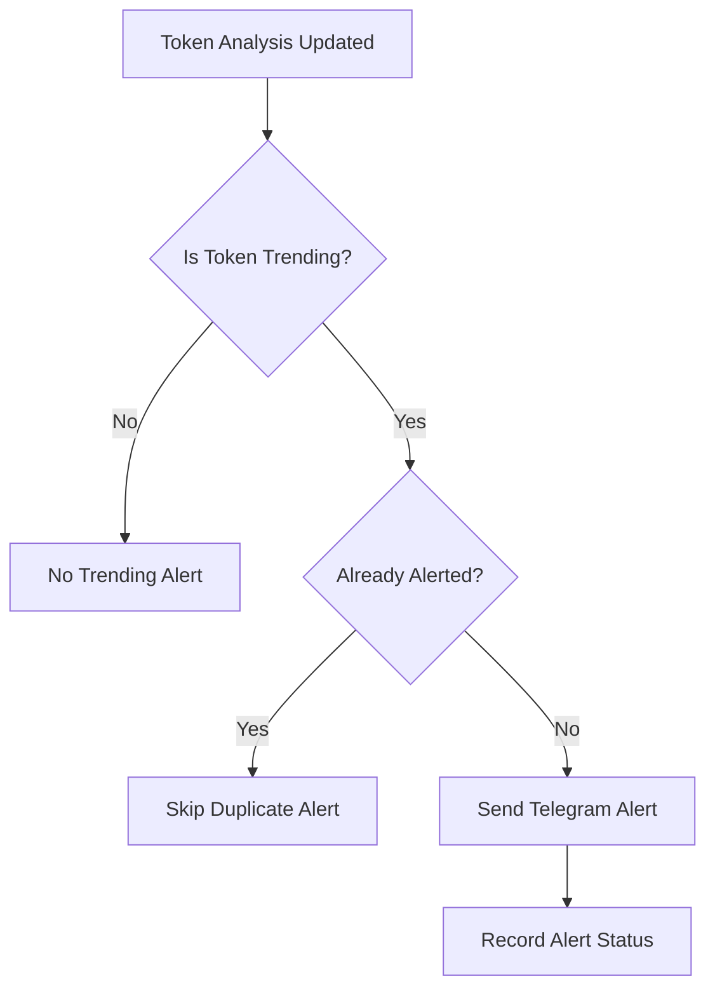

# MeMeIt — Solana Meme Token Intelligence Platform

Real-time intelligence dashboard for monitoring Solana meme tokens. Automatically discovers, scores, and categorizes newly graduated tokens from pump.fun and Raydium, providing risk analysis, market tracking, and real-time alerts.

## Features

- **Automated Token Discovery** — Discover new tokens through DexScreener and Helius.
- **Graduation Validation** — Validate liquidity pool creation and filter unwanted tokens.
- **On-Chain Analysis** — Monitor market cap, liquidity, holders, and token activity.
- **Risk Scoring** — Generate risk scores from 0–100 using security checks and creator history.
- **Social Analysis** — Analyze available Twitter/X metrics.
- **Real-Time Dashboard** — Monitor tokens through a web dashboard with Server-Sent Events (SSE).
- **Telegram Bot** — Look up tokens using their contract addresses and receive Trending alerts.
- **Background Processing** — Process analysis tasks asynchronously using Huey and Redis.
- **Shared API Cache** — Cache API responses to reduce repeated database queries.
- **Token Lifecycle Tracking** — Categorize tokens based on age, risk, market activity, and performance.

---

## Architecture Overview



## Tech Stack

| Component | Technology |
|---|---|
| Backend API | Python, FastAPI |
| Background Tasks | Huey |
| Task Queue / Cache | Redis |
| Database | SQLite |
| Dashboard | Vanilla JavaScript, CSS, Vite |
| Telegram Integration | python-telegram-bot |
| Market Data | DexScreener API |
| Blockchain Data | Helius RPC and WebSocket |
| Security Analysis | RugCheck API |
| Social Analysis | Twitter/X data sources |
| Live Updates | Server-Sent Events (SSE) |
| Configuration | Environment variables |

---

## Project Structure

```text
MeMeIt/
├── src/
│   ├── api.py
│   ├── bot.py
│   ├── workers.py
│   ├── graduation_ai.py
│   ├── graduation_scraper.py
│   ├── graduation_wss.py
│   ├── bootstrap.py
│   ├── config.py
│   │
│   ├── core/
│   │   ├── database.py
│   │   ├── on_chain.py
│   │   ├── social.py
│   │   ├── scoring.py
│   │   ├── rugcheck.py
│   │   ├── creator.py
│   │   ├── helius.py
│   │   └── report.py
│   │
│   └── utils/
│       ├── db.py
│       ├── redis.py
│       └── telegram.py
│
├── dashboard/
│   ├── index.html
│   ├── main.js
│   └── src/
│       └── style.css
│
├── data/
│   └── meme_it.db
│
├── start.sh
├── requirements.txt
├── .env.example
├── .gitignore
└── README.md
```

*Note: `data/meme_it.db` is created or initialized by the application as configured. The exact files and folders depend on the current implementation.*

---

## Token Lifecycle



## Token Categories

| Category | Description |
|---|---|
| **Graduated** | Newly discovered tokens awaiting initial analysis. |
| **Gems (24H)** | Tokens under 24 hours old that meet the configured scoring and liquidity criteria. |
| **Established** | More mature tokens meeting configured fundamental criteria. |
| **Legacy (+7D)** | Tokens older than seven days that remain active and meet configured criteria. |
| **Trending** | Tokens showing qualifying market-cap growth or momentum. |
| **Hall of Fame** | Tokens reaching a market cap of $500,000 or a 10x performance milestone, according to the configured rules. |
| **Scam Trending** | Risk-flagged tokens that continue to show significant market activity. |
| **Scams** | Tokens that fail configured security checks. |
| **Rugged** | Tokens identified as rug pulls based on available evidence and configured detection rules. |
| **Died / Low MC** | Tokens with low market capitalization or insufficient activity that may qualify for pruning. |

*Category membership depends on the implemented scoring rules, data availability, and configured thresholds. A risk score is an indicator, not a guarantee of safety.*

---

## Data Flow



### Scalability and Caching

The application separates token discovery and background analysis from dashboard requests.

1. **Discovery workers** collect token data from configured sources.
2. **Graduation validation** checks whether a token meets the configured discovery criteria.
3. **Huey workers** perform background analysis and scoring.
4. **SQLite** stores token records and analysis results.
5. **Redis** caches eligible API responses for the configured TTL.
6. **FastAPI** serves the dashboard and SSE updates.
7. **Telegram** sends notifications when the configured Trending alert conditions are satisfied.

The intended design is for dashboard users to read shared cached data instead of triggering independent discovery jobs. Actual database query frequency and concurrency capacity depend on cache implementation, cache invalidation, SSE handling, worker configuration, and deployment resources.

---

## Telegram Bot

The Telegram bot supports the following features:

- Manual token lookup using a contract address (CA).
- Detailed token information and available risk analysis.
- Trending-token notifications.
- Configurable authorized-user access.
- Duplicate alert prevention through a database flag.

### Trending Alert Logic



The intended behavior is to notify only when a token newly qualifies for Trending and to avoid duplicate alerts. This requires the alert state to be stored and updated reliably.

Manual contract-address lookups are handled separately from automatic Trending alerts.

---

## API Endpoints

| Endpoint | Method | Description |
|---|---|---|
| `/api/tokens` | GET | Retrieve monitored tokens. |
| `/api/token/{ca}` | GET | Retrieve details for a specific token. |
| `/api/report/{ca}` | GET | Retrieve a detailed risk-analysis report. |
| `/api/stream` | GET | Receive live updates through SSE. |
| `/api/webhook/helius` | POST | Receive configured Helius webhook events. |

The endpoints above describe the intended API interface. Confirm the actual routes, authentication, and response formats against `src/api.py`.

---

## Requirements

- Python 3.10 or newer
- Redis server
- Node.js 18 or newer
- npm
- Git
- A Helius API key for configured Helius integrations
- A Telegram bot token for Telegram functionality

Some data sources may require additional API credentials or have usage limits.

---

## Installation

### 1. Clone the Repository

Replace `your-username` with the actual GitHub account or organization that owns the repository.

```bash
git clone https://github.com/your-username/MeMeIt.git
cd MeMeIt
```

### 2. Create a Python Virtual Environment

```bash
python3 -m venv venv
source venv/bin/activate
```

On Windows, activate it using:

```powershell
venv\Scripts\activate
```

### 3. Install Python Dependencies

```bash
pip install --upgrade pip
pip install -r requirements.txt
```

### 4. Install Dashboard Dependencies

```bash
cd dashboard
npm install
cd ..
```

### 5. Configure Environment Variables

Create the environment file:

```bash
cp .env.example .env
```

Edit `.env` with your actual configuration.

Example:

```env
TELEGRAM_BOT_TOKEN=your_telegram_bot_token
HELIUS_API_KEY=your_helius_api_key
AUTHORIZED_USER_IDS=your_telegram_user_id
```

Configure any additional variables required by `src/config.py`, including Redis connection settings, API credentials, and application options.

**Security:** Never commit `.env`, API keys, bot tokens, or other secrets to GitHub. Keep `.env.example` limited to placeholder values.

### 6. Start Redis

Make sure Redis is installed and running before starting the workers.

For a local Redis installation on Linux:

```bash
redis-cli ping
```

A working Redis server should return:

```text
PONG
```

If Redis is not running, start the service using the appropriate command for your operating system.

### 7. Start MeMeIt

Make the startup script executable:

```bash
chmod +x start.sh
```

Start the application:

```bash
./start.sh
```

The startup script is intended to launch the configured application components:

- FastAPI backend on port `8000`
- Huey background workers
- DexScreener polling scraper
- Helius WebSocket listener
- Vite dashboard on port `5173`
- Telegram bot

Actual startup behavior depends on the processes configured in `start.sh`.

---

## Dashboard Access

After starting the application, open:

- **Web Dashboard:** http://localhost:5173
- **Backend API:** http://localhost:8000
- **API Documentation:** http://localhost:8000/docs

The API documentation URL is available when FastAPI's interactive documentation is enabled.

---

## Configuration

| Setting | Purpose |
|---|---|
| `TELEGRAM_BOT_TOKEN` | Telegram bot authentication. |
| `HELIUS_API_KEY` | Helius API access. |
| `AUTHORIZED_USER_IDS` | Restrict Telegram bot access to configured user IDs. |
| Redis connection settings | Configure task queue and cache connectivity. |
| Database path | Configure the SQLite database location. |
| Scraper interval | Configure token discovery polling frequency. |
| Cache TTL | Configure how long API responses remain cached. |

The actual environment variable names and defaults are defined by the application configuration.

---

## Risk Analysis

MeMeIt combines multiple sources of information to assess token risk.

| Analysis Component | Purpose |
|---|---|
| Market Metrics | Review market capitalization, liquidity, and trading activity. |
| Holder Analysis | Examine available token holder distribution data. |
| Liquidity Checks | Evaluate available liquidity pool information. |
| RugCheck | Retrieve available token security indicators. |
| Creator History | Analyze available information about token creator wallets. |
| Social Metrics | Review available Twitter/X activity and account metrics. |
| Risk Scoring | Combine configured signals into a normalized score. |

Risk scoring depends on the completeness and accuracy of upstream data. Missing data should be distinguished from verified safe conditions. No score or external security service can guarantee that a token is safe.

---

## Database

The application uses SQLite for persistent token and analysis records.

Intended database location:

```text
data/meme_it.db
```

Database responsibilities may include:

- Token records and contract addresses.
- Market and analysis metrics.
- Risk scores and category assignments.
- Monitoring state.
- Trending alert status.
- Timestamps and historical tracking fields.

The database schema and migrations are managed by `src/core/database.py`.

For deployments with concurrent writes, review SQLite transaction handling, connection management, WAL configuration, and backup procedures.

---

## Monitoring and Maintenance

Recommended operational checks:

- Verify Redis is reachable.
- Check scraper and WebSocket connection status.
- Monitor Huey worker failures and retries.
- Review API logs and SSE connection behavior.
- Check cache invalidation and stale market data.
- Back up the SQLite database.
- Review API rate limits and upstream service availability.
- Confirm that Telegram alerts are not duplicated.
- Validate risk signals before automatically changing token categories.

Do not expose Redis, database files, internal management endpoints, or API credentials publicly.

---

## Troubleshooting

### Dashboard does not load

1. Confirm that the Vite server is running.
2. Check whether port `5173` is available.
3. Review browser console errors.
4. Confirm that API requests target the correct backend URL.

### API does not respond

1. Confirm FastAPI is running on port `8000`.
2. Check the backend logs.
3. Verify environment variables.
4. Confirm that SQLite and Redis are accessible.

### Tokens are not appearing

1. Check DexScreener API responses.
2. Verify Helius configuration if WebSocket discovery is enabled.
3. Inspect graduation validation rules.
4. Check Huey worker logs.
5. Confirm that discovered tokens are being saved to the database.

### Telegram alerts are missing

1. Verify `TELEGRAM_BOT_TOKEN`.
2. Confirm the configured authorized user IDs where applicable.
3. Check whether the token meets the Trending criteria.
4. Review the stored alert status.
5. Inspect Telegram API errors.

---

## Development Guidelines

- Keep discovery and background processing separate from API request handlers.
- Reuse cached responses where appropriate.
- Validate and normalize token contract addresses.
- Handle upstream API errors and rate limits.
- Make alert delivery idempotent to prevent duplicate notifications.
- Keep credentials in environment variables.
- Use database migrations when changing the schema.
- Test scoring and categorization rules against representative token data.
- Do not treat incomplete security data as proof that a token is safe.

---

## Disclaimer

MeMeIt is a token-monitoring and research tool. It does not guarantee token safety, future performance, liquidity, or profitability.

Cryptocurrency and meme tokens are highly volatile and may involve scams, liquidity withdrawal, malicious contracts, and total loss of funds. Risk scores and classifications are informational signals, not financial advice. Always conduct independent research before making financial decisions.

## License

This project is licensed under the MIT License, unless otherwise specified in the repository.
